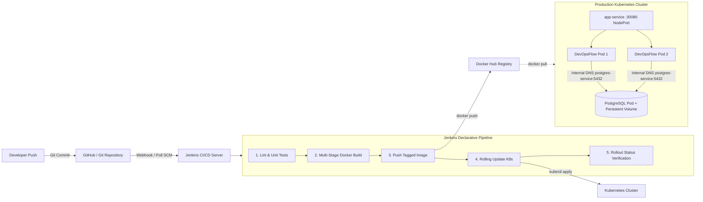

# 🚢 Complete Step-by-Step Jenkins CI/CD Deployment Guide
### Production-Grade Deployment for **DevOpsFlow Portal** (Node.js + PostgreSQL + Docker + Kubernetes)

---

## 📑 Table of Contents
1. [Architecture & Pipeline Overview](#1-architecture--pipeline-overview)
2. [Prerequisites Checklist](#2-prerequisites-checklist)
3. [Step 1: Docker Hub Setup (Image Registry)](#step-1-docker-hub-setup-image-registry)
4. [Step 2: Kubernetes Cluster Preparation](#step-2-kubernetes-cluster-preparation)
5. [Step 3: Launching Jenkins with Docker & Kubectl Access](#step-3-launching-jenkins-with-docker--kubectl-access)
6. [Step 4: Jenkins Initial Setup & Plugin Installation](#step-4-jenkins-initial-setup--plugin-installation)
7. [Step 5: Configuring Credentials in Jenkins](#step-5-configuring-credentials-in-jenkins)
8. [Step 6: Creating the Jenkins Declarative Pipeline Job](#step-6-creating-the-jenkins-declarative-pipeline-job)
9. [Step 7: Executing the CI/CD Pipeline & Monitoring Builds](#step-7-executing-the-cicd-pipeline--monitoring-builds)
10. [Step 8: Verifying the Live Deployed Application & PostgreSQL](#step-8-verifying-the-live-deployed-application--postgresql)
11. [Step 9: Testing Zero-Downtime Rolling Updates](#step-9-testing-zero-downtime-rolling-updates)
12. [Step 10: Troubleshooting & Common Gotchas](#step-10-troubleshooting--common-gotchas)

---

## 1. Architecture & Pipeline Overview

This repository implements a full continuous delivery lifecycle:



### Key Components:
- **Application**: `devopsflow-portal` (Node.js 20, Express, Real-time Dashboard, REST API)
- **Database**: PostgreSQL 16 with Persistent Volume Claim (`postgres-pvc`)
- **Container Registry**: Docker Hub (Public / Private repository)
- **Orchestration**: Kubernetes Deployments with `RollingUpdate` strategy (`maxUnavailable: 0`)
- **CI/CD Automation**: Jenkins Declarative Pipeline (`Jenkinsfile`)

---

## 2. Prerequisites Checklist

Ensure you have the following installed on your host system:

| Component | Minimum Version | Verification Command |
| :--- | :--- | :--- |
| **Git** | 2.30+ | `git --version` |
| **Node.js** | 18+ or 20+ | `node -v` |
| **Docker Desktop** | 4.20+ | `docker version` |
| **Kubernetes** | 1.25+ | `kubectl cluster-info` |
| **Docker Hub Account** | Free tier | [hub.docker.com](https://hub.docker.com) |

---

## Step 1: Docker Hub Setup (Image Registry)

Jenkins needs a container registry where it can push newly built Docker images, which Kubernetes will pull during deployment.

1. Navigate to **[hub.docker.com](https://hub.docker.com)** and log in.
2. Click **Create Repository**:
   - **Repository Name**: `devopsflow-portal`
   - **Visibility**: **Public** *(recommended for simple pulling without needing Kubernetes imagePullSecrets)*
   - Click **Create**.
3. Generate a **Personal Access Token (PAT)** (safer than using your raw account password):
   - Click your profile icon (top-right) -> **Account Settings**.
   - Select **Security** -> **New Access Token**.
   - **Access Token Description**: `jenkins-cicd-token`
   - **Access Permissions**: **Read & Write**
   - Click **Generate Token** and **copy the secret token** immediately (you will paste this in Jenkins).

---

## Step 2: Kubernetes Cluster Preparation

You can use **Docker Desktop's built-in Kubernetes** or **Minikube**.

### Option A: Using Docker Desktop (Recommended on Windows / Mac)
1. Open Docker Desktop -> Click the **Gear icon** (Settings).
2. Go to **Kubernetes** tab.
3. Check **Enable Kubernetes** and click **Apply & restart**.
4. Wait until the Kubernetes status icon at the bottom-left turns green.
5. In your terminal, verify cluster connectivity:
   ```bash
   kubectl cluster-info
   kubectl get nodes
   ```

### Option B: Using Minikube
```bash
minikube start --driver=docker
kubectl get nodes
```

### ⚠️ Critical Step: Prepare Kubeconfig for Jenkins
Jenkins runs inside a Docker container. In your default host kubeconfig (`~/.kube/config` or `C:\Users\<user>\.kube\config`), the cluster URL is often:
```yaml
server: https://127.0.0.1:6443
```
Because `127.0.0.1` inside a container refers to the container itself, Jenkins will fail to connect.
1. Make a copy of your `config` file named `jenkins-kubeconfig.yaml`.
2. Open `jenkins-kubeconfig.yaml` in a text editor.
3. Change:
   ```yaml
   server: https://127.0.0.1:6443
   ```
   to:
   ```yaml
   server: https://host.docker.internal:6443
   ```
   *(If using Linux without Docker Desktop, use your host machine's LAN IP address e.g. `https://192.168.1.50:6443`).*
4. Keep this file ready for Jenkins upload in Step 5.

---

## Step 3: Launching Jenkins with Docker & Kubectl Access

Run the official Jenkins LTS container, mounting the host Docker socket so Jenkins can build and push containers:

### On Windows (PowerShell):
```powershell
docker run -d `
  --name jenkins `
  --restart=always `
  -p 8080:8080 `
  -p 50000:50000 `
  -v jenkins_home:/var/jenkins_home `
  -v //var/run/docker.sock:/var/run/docker.sock `
  -u root `
  jenkins/jenkins:lts
```

### On Linux / macOS:
```bash
docker run -d \
  --name jenkins \
  --restart=always \
  -p 8080:8080 \
  -p 50000:50000 \
  -v jenkins_home:/var/jenkins_home \
  -v /var/run/docker.sock:/var/run/docker.sock \
  -u root \
  jenkins/jenkins:lts
```

### Install `docker-cli` and `kubectl` inside Jenkins:
Run the following one-liner to install Docker CLI and Kubectl inside the running Jenkins container:

```bash
docker exec -u 0 -it jenkins bash -c "
  apt-get update && \
  apt-get install -y curl apt-transport-https ca-certificates && \
  # Install Docker CLI
  curl -fsSL https://get.docker.com | sh && \
  # Install Kubectl
  curl -LO https://dl.k8s.io/release/\$(curl -L -s https://dl.k8s.io/release/stable.txt)/bin/linux/amd64/kubectl && \
  chmod +x kubectl && \
  mv kubectl /usr/local/bin/ && \
  # Install Node.js & npm (for lint & tests stage)
  curl -fsSL https://deb.nodesource.com/setup_20.x | bash - && \
  apt-get install -y nodejs
"
```

Verify installations inside Jenkins:
```bash
docker exec -it jenkins docker --version
docker exec -it jenkins kubectl version --client
docker exec -it jenkins node -v
```

---

## Step 4: Jenkins Initial Setup & Plugin Installation

1. Open your browser and navigate to **`http://localhost:8080`**.
2. Retrieve the initial administrator password:
   ```bash
   docker exec -it jenkins cat /var/jenkins_home/secrets/initialAdminPassword
   ```
3. Paste the password into the web setup page and click **Continue**.
4. Select **Install suggested plugins** and wait for the installer to finish.
5. Create your initial admin user (or select *Continue as admin*).
6. Next, install required CI/CD plugins:
   - Navigate to **Manage Jenkins** -> **Plugins** -> **Available Plugins**.
   - Search and check:
     - ✅ **Docker Pipeline**
     - ✅ **Kubernetes CLI**
     - ✅ **Credentials Binding**
     - ✅ **Git**
     - ✅ **Pipeline**
   - Click **Install without restart** (or check *Restart Jenkins when installation is complete*).

---

## Step 5: Configuring Credentials in Jenkins

Our pipeline requires two credentials securely managed in Jenkins:

### Credential 1: Docker Hub Authentication (`dockerhub-credentials`)
1. In Jenkins dashboard, go to **Manage Jenkins** -> **Credentials**.
2. Click **(global)** under Domains -> Click **Add Credentials** (top right).
3. Fill in the fields:
   - **Kind**: `Username with password`
   - **Scope**: `Global (Jenkins, nodes, items, all child items...)`
   - **Username**: *Your Docker Hub username* (e.g. `johndoe`)
   - **Password**: *Your Docker Hub Personal Access Token (from Step 1)*
   - **ID**: `dockerhub-credentials` *(⚠️ Must match this exact ID)*
   - **Description**: `Docker Hub Registry Credentials`
4. Click **Create**.

### Credential 2: Kubernetes Kubeconfig (`k8s-kubeconfig`)
1. Click **Add Credentials** again.
2. Fill in the fields:
   - **Kind**: `Secret file`
   - **Scope**: `Global`
   - **File**: Click **Choose File** and upload your edited `jenkins-kubeconfig.yaml` (from Step 2).
   - **ID**: `k8s-kubeconfig` *(⚠️ Must match this exact ID)*
   - **Description**: `Kubernetes Kubeconfig Cluster Access`
3. Click **Create**.

---

## Step 6: Creating the Jenkins Declarative Pipeline Job

1. Return to the Jenkins home page and click **New Item** (left menu).
2. Enter Item Name: `devopsflow-cicd-pipeline`.
3. Select **Pipeline** as the project type and click **OK**.
4. In the Job Configuration page:
   - Under **General**, check **This project is parameterized** (optional, as our `Jenkinsfile` already declares its parameters).
   - Scroll down to the **Pipeline** section:
     - **Definition**: Select `Pipeline script from SCM`.
     - **SCM**: Select `Git`.
     - **Repository URL**: Enter your GitHub / GitLab repository URL (e.g. `https://github.com/yourusername/devops-pipeline-project.git`).
     - **Branch Specifier**: `*/main` (or `*/master`).
     - **Script Path**: `Jenkinsfile`.
5. Click **Save**.

### ⚠️ Update Your Docker Hub Username in `Jenkinsfile`
Before running the build, ensure line 6 in `Jenkinsfile` matches your actual Docker Hub username:
```groovy
environment {
    DOCKER_HUB_USER = 'yourdockerhubuser' // Change this to your username!
    IMAGE_NAME      = "${DOCKER_HUB_USER}/devopsflow-portal"
    ...
```
Commit and push this change to your repository:
```bash
git commit -am "chore: configure Docker Hub username in Jenkinsfile"
git push origin main
```

---

## Step 7: Executing the CI/CD Pipeline & Monitoring Builds

1. In your Jenkins job page, click **Build with Parameters** (or **Build Now**).
2. Review the build options:
   - `ENVIRONMENT`: `production` (default)
   - `FORCE_DEPLOY`: `false`
3. Click **Build**.
4. Click on the build number (e.g. `#1`) on the left side and select **Console Output** to watch the execution live!

### Pipeline Execution Stages:

```
[Pipeline] stage: 🧹 Workspace Setup
🚀 Starting CI/CD Pipeline for Build #1
Target Environment: production
Image: yourdockerhubuser/devopsflow-portal:1

[Pipeline] stage: 🧪 Lint & Unit Tests
📦 Installing application dependencies...
🔬 Running automated unit, integration, and database API tests...
# tests 8
# suites 0
# pass 8
# fail 0

[Pipeline] stage: 🐳 Build Docker Image
🔨 Building Docker image: yourdockerhubuser/devopsflow-portal:1 ...
Successfully tagged yourdockerhubuser/devopsflow-portal:1
Successfully tagged yourdockerhubuser/devopsflow-portal:latest

[Pipeline] stage: 📤 Push to Docker Registry
🔐 Authenticating with Docker Registry...
The push refers to repository [docker.io/yourdockerhubuser/devopsflow-portal]
1: digest: sha256:... size: 1364
latest: digest: sha256:... size: 1364

[Pipeline] stage: ☸️ Deploy to Kubernetes
🚀 Applying Kubernetes manifests...
secret/postgres-secret configured
persistentvolumeclaim/postgres-pvc unchanged
deployment.apps/postgres-deployment configured
service/postgres-service unchanged
deployment.apps/app-deployment configured
service/app-service unchanged
⏳ Waiting for app rollout to finish...
deployment "app-deployment" successfully rolled out

[Pipeline] stage: 🔍 Verify Deployment
📊 --- Running Pods ---
NAME                                READY   STATUS    RESTARTS   AGE
app-deployment-647d7c6798-2m4xp     1/1     Running   0          25s
app-deployment-647d7c6798-v8x2w     1/1     Running   0          25s
postgres-deployment-788dfc-w2jkl    1/1     Running   0          2m

🎉 DEPLOYMENT SUCCEEDED!
```

---

## Step 8: Verifying the Live Deployed Application & PostgreSQL

### 1. Inspect Cluster Workloads
Run these commands from your host terminal:

```bash
# Check all running pods
kubectl get pods -l app=devopsflow-portal
kubectl get pods -l app=postgres

# Check persistent storage
kubectl get pvc,pv

# Check exposed services
kubectl get svc app-service postgres-service
```

### 2. Access the Application in Your Browser

#### Method 1: Via NodePort (Port 30080)
Open: **`http://localhost:30080`**

#### Method 2: Via Kubectl Port-Forwarding (Universal)
```bash
kubectl port-forward svc/app-service 3000:3000
```
Open: **`http://localhost:3000`**

### 3. Verify PostgreSQL Persistence
1. In the web dashboard at `http://localhost:3000`, type a new task:
   `"Verify production ingress and SSL certificates"` and click **+ Add Task**.
2. Notice the badge shows: **`Storage: PostgreSQL Active`**.
3. Now test database persistence across pod restarts! Delete one of the web application pods:
   ```bash
   kubectl delete pod <pod-name-from-dashboard>
   ```
4. Kubernetes will automatically start a replacement pod in 2 seconds.
5. Refresh the page: **Your tasks remain intact in PostgreSQL!**

---

## Step 9: Testing Zero-Downtime Rolling Updates

To witness automated CI/CD and Kubernetes rolling updates in action:

1. Open `src/app.js` and edit line 11:
   ```javascript
   const APP_VERSION = process.env.APP_VERSION || '2.0.0';
   ```
2. Commit and push:
   ```bash
   git commit -am "feat: upgrade to release v2.0.0"
   git push origin main
   ```
3. In Jenkins, click **Build Now**.
4. In your terminal, watch the rolling update live:
   ```bash
   kubectl get pods -l app=devopsflow-portal -w
   ```
5. You will observe:
   - Pod 1 of v2.0.0 spins up.
   - Kubernetes runs the `/health` readiness probe.
   - Once healthy, Kubernetes routes traffic to it and terminates one old v1.0.0 pod.
   - Pod 2 of v2.0.0 spins up and replaces the second old pod.
   - **Zero dropped connections and zero seconds of downtime!**

---

## Step 10: Troubleshooting & Common Gotchas

| Issue | Root Cause | Exact Solution |
| :--- | :--- | :--- |
| **`docker: permission denied while connecting to docker daemon`** | Jenkins container user doesn't have permissions for `/var/run/docker.sock`. | Re-run Jenkins with `-u root`, or run `docker exec -u 0 -it jenkins usermod -aG docker jenkins` and restart Jenkins. |
| **`ImagePullBackOff` / `ErrImagePull`** | Kubernetes cannot find the Docker image tag or repository. | 1. Ensure `DOCKER_HUB_USER` in `Jenkinsfile` matches your Docker Hub username.<br>2. Confirm repository visibility is **Public** on Docker Hub. |
| **`kubectl: command not found` in Jenkins** | Kubectl is not installed inside the Jenkins container. | Run the setup script in [Step 3](#step-3-launching-jenkins-with-docker--kubectl-access) to install kubectl in Jenkins. |
| **`Unable to connect to the server: connection refused (127.0.0.1:6443)`** | Jenkins is inside Docker; `127.0.0.1` tries to reach the container itself rather than the host K8s cluster. | Edit your kubeconfig uploaded to Jenkins to use `https://host.docker.internal:6443` instead of `127.0.0.1:6443`. |
| **`postgres-pvc` remains in `Pending`** | No default StorageClass configured in Kubernetes cluster. | Verify storage classes with `kubectl get storageclass`. On Docker Desktop or Minikube, enable the default hostpath storage provisioner. |
| **App shows `Storage: In-Memory Fallback`** | PostgreSQL pod is still starting up or credentials mismatch. | Wait 15 seconds for PostgreSQL initialization. Check logs with `kubectl logs -l app=postgres`. Our app auto-reconnects in the background! |

---

## 🏆 Summary

You now have a complete, production-grade, enterprise DevOps pipeline:
- **Clean Naming & Architecture**: `DevOpsFlow Portal`
- **Resilient Database Layer**: PostgreSQL with connection retry, auto-schema migration, and latency monitoring
- **Immutable Multi-Stage Containerization**: Non-root Docker Alpine image
- **Automated Declarative Pipeline**: 6 automated stages in `Jenkinsfile`
- **Zero-Downtime Orchestration**: Kubernetes Rolling Updates with health probes
